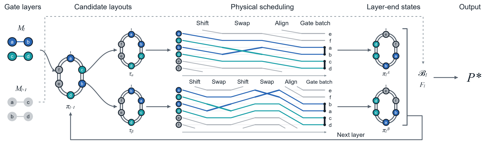
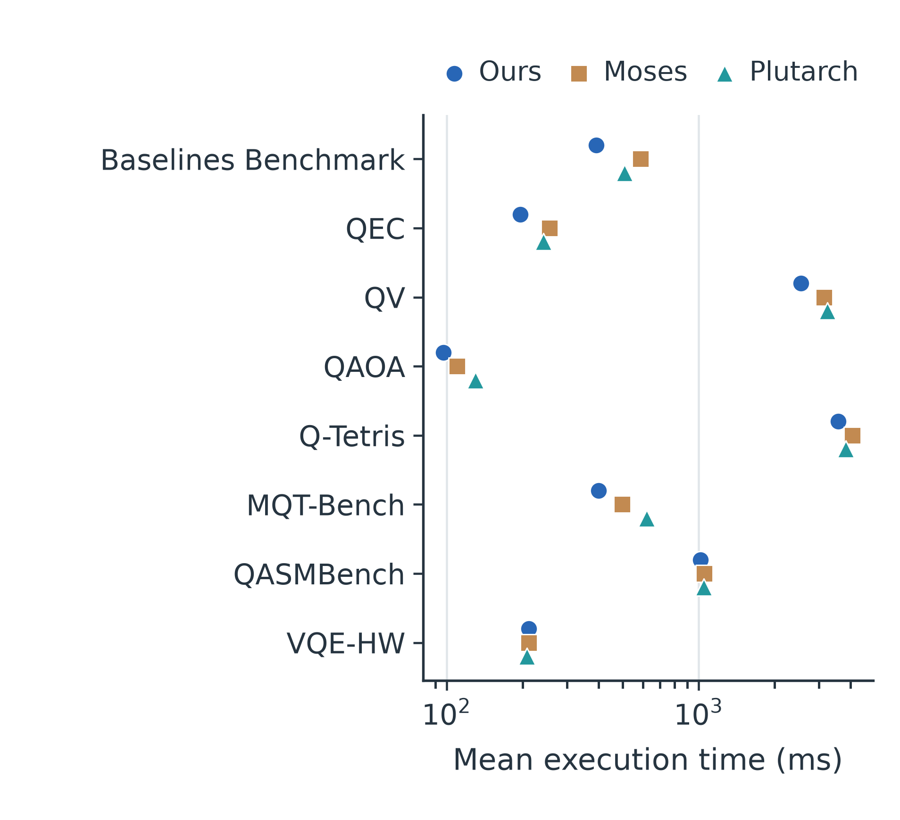

# Cross-Layer Layout and Scheduling for Racetrack QCCD Quantum Processors

Racetrack quantum charge-coupled device (QCCD) processors use ion transport to bring interacting qubits to shared gate zones. The arrangement of ions affects both the movements needed for the current interactions and the transport required by subsequent gate layers. Efficient compilation therefore depends on coordinating ion layout, parallel transport, and gate execution throughout a circuit.

Our work develops a cross-layer layout and scheduling framework to reduce unnecessary ion movement and organize physical exchanges into efficient parallel rounds. The framework compares execution plans using their complete modeled execution time and carries the resulting ion arrangements forward, allowing upcoming interactions to guide decisions across layers.

## Framework



*Candidate execution paths and the propagation of realized ion layouts across gate layers.*

The framework combines three components:

- **Candidate layout generation** constructs ion arrangements that place the current interacting pairs next to one another while exploring alternative block orders and orientations.
- **Transport and gate-zone scheduling** converts each candidate into physical movements and gate batches, accounting for parallel exchanges and the positions of available gate zones.
- **Cross-layer state selection** compares the resulting schedules using accumulated execution time and upcoming interaction demands. Paths reaching the same ion arrangement are merged, and promising arrangements are retained for subsequent layers.

Together, these components connect the cost of executing each layer with the ion positions it leaves behind, reducing transport over the complete circuit.

## Results

The evaluation covers **372 circuits** under a shared H2-32 hardware and timing model, with **Moses** and **Plutarch** as the comparison methods. The proposed framework reduces mean modeled execution time, physical exchanges, and exchange rounds:

| Metric | Reduction relative to Moses | Reduction relative to Plutarch |
| --- | ---: | ---: |
| Mean execution time | 13.5% | 15.3% |
| Physical exchanges | 28.0% | 38.5% |
| Exchange rounds | 42.9% | 59.0% |

<p align="center">
  
</p>

*Arithmetic mean circuit execution time within each benchmark group.*

Transport savings account for most of the execution-time improvement. The fidelity analysis reports higher mean fidelity proxies than both comparison methods in seven benchmark groups. The accompanying data also cover the time decomposition, circuit-group comparisons, search ablations, and timing sensitivity analyses presented in the paper.

## Benchmark suite

The suite contains circuits with at most 32 qubits, spanning algorithmic workloads, variational circuits, quantum error correction, state preparation, and randomized interactions. All **372 input circuits** are provided as OpenQASM files, preserving their original 2.0 or 3.0 format.

| Benchmark group | Circuits | Workloads | QASM directory |
| --- | ---: | --- | --- |
| MQT-Bench | 112 | Algorithms, random circuits, and state preparation | [mqt_bench](benchmarks/qasm/mqt_bench/) |
| Three-regular-graph QAOA | 80 | Graph-optimization interactions | [qaoa](benchmarks/qasm/qaoa/) |
| Dedicated QEC group | 58 | Encoding and syndrome extraction | [qec](benchmarks/qasm/qec/) |
| QASMBench | 40 | Low-level benchmark programs | [qasmbench](benchmarks/qasm/qasmbench/) |
| Q-Tetris | 33 | Structured circuit workloads | [q_tetris](benchmarks/qasm/q_tetris/) |
| VQE-HW | 32 | Hardware-efficient variational circuits | [vqe_hw](benchmarks/qasm/vqe_hw/) |
| Baseline benchmarks | 11 | Representative workloads of the compared strategies | [baseline](benchmarks/qasm/baseline/) |
| Quantum volume | 6 | Random model circuits | [quantum_volume](benchmarks/qasm/quantum_volume/) |
| **Total** | **372** | | |

The suite includes **62 QEC-related circuits** across the source groups, covering repetition codes, the five-qubit code, the Steane code, and the Shor code. Of these, 58 belong to the dedicated QEC group. The qubit-count groups contain 56 circuits with at most 8 qubits, 142 with 9–16 qubits, and 174 with 17–32 qubits.

## Repository contents

```text
.
├── README.md
├── assets/
│   ├── framework.svg
│   └── execution_time_by_benchmark.png
├── benchmarks/
│   ├── circuits.csv
│   └── qasm/
│       ├── baseline/
│       ├── mqt_bench/
│       ├── qaoa/
│       ├── qasmbench/
│       ├── qec/
│       ├── q_tetris/
│       ├── quantum_volume/
│       └── vqe_hw/
├── results/
│   ├── comparison.csv
│   ├── search_configuration.csv
│   └── timing_sensitivity.csv
├── docs/
│   ├── data_format.md
│   └── sources.md
└── licenses/
```

| File | Contents |
| --- | --- |
| [circuits.csv](benchmarks/circuits.csv) | Circuit identifiers, benchmark groups, qubit counts, workload categories, and circuit characteristics. |
| [comparison.csv](results/comparison.csv) | 1,116 circuit–method records: execution time and its components, physical operation counts, and fidelity proxies. |
| [search_configuration.csv](results/search_configuration.csv) | Mean execution and compilation times for the six search configurations reported in the paper. |
| [timing_sensitivity.csv](results/timing_sensitivity.csv) | Mean execution times for all three methods under the four reported timing variations. |

The `circuit_id` field connects the circuit information, QASM inputs, and comparison results. For example, `C001` corresponds to `benchmarks/qasm/baseline/C001.qasm` and the three rows for `C001` in `comparison.csv`. Use the benchmark-group table above to locate each circuit's directory.

CSV files use UTF-8 encoding, comma separators, and a header row. File contents and units are summarized in [Data format](docs/data_format.md).

Benchmark sources and their license notices are listed in [Sources](docs/sources.md).

This repository contains the complete benchmark circuit collection and the experimental data supporting all quantitative results reported in the paper, including the main comparison, workload analyses, fidelity evaluation, search ablations, and timing sensitivity analysis.
